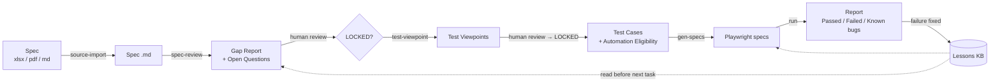

# AI-Assisted QA Framework

An AI-first QA workflow that takes a feature from **spec → gap analysis → test viewpoints → test cases → Playwright automation → report**, with human review gates at every step and a lessons knowledge base that makes the AI better after every mistake.

Built and used in production by a Senior QA engineer on a Japanese-market B2B SaaS product. This public version contains the framework only: all client data has been removed and the demo runs against a public practice site.

   [](https://github.com/hieunguyenauto/ai-qa-framework/actions/workflows/ci.yml)

---

## Why this exists

AI can write test cases fast, but it also invents requirements, skips edge cases and writes flaky locators. This framework keeps the speed and removes the guesswork:

| Problem with "just ask the AI" | How the framework handles it |
| --- | --- |
| AI invents requirements | No spec path → `BLOCKED_INPUT`. Unclear spec → logged as an Open Question, never guessed. Message text must exist in `spec/messages.md`. |
| Output is not reviewed | Every artifact goes DRAFT → human review → LOCKED. Locked files cannot be edited without a new revision. |
| Same mistake repeated | Every fixed failure becomes a reviewed **lesson** that the AI must read before the next task. |
| Test cases and code drift apart | Automation reads **only** LOCKED test cases; a generator turns them into Playwright specs, `--check` reports drift and each spec refuses to run against a newer TC revision. |
| Flaky locators | Locators live in one screen store and must come from a real recon run of the page. |
| Known bugs turn CI red forever | A confirmed bug stays in `bug-history.md`; its test runs as an expected failure with the bug ID and turns red only when the bug is fixed. |

## Pipeline



## Repository structure

```
.
├── CLAUDE.md                  # Rules the AI must follow (source of truth for behaviour)
├── .claude/skills/            # One skill per pipeline step
├── qc/
│   ├── templates/             # spec, gap-report, viewpoint, testcase, data-test (Japanese input rows)
│   └── lessons/               # Test-design rules (D01…D19) + INDEX.md
├── automation/
│   ├── templates/screen.md    # Screen / locator template
│   └── lessons/               # Automation rules (R01…R45) + detailed write-ups
├── manager/                   # Decisions log, CHANGELOG, handbook, generated GUIDE.md
├── scripts/check-before-push.sh  # Public-safety scan (secrets, client words, history)
└── examples/
    └── demo-shop/             # Full pipeline on a public demo site
        ├── spec/              # checkout.md + messages.md
        ├── qc/                # gap report, open questions, viewpoints, test cases (LOCKED)
        ├── screens/           # flow + screen catalog
        ├── bug-history.md
        └── automation/web/    # Playwright project (generator, screens, reporter)
```

## Skills

| Skill | Input | Output |
| --- | --- | --- |
| `source-import` | Client spec (xlsx / pdf / docx) | Spec in Markdown, row reconciliation, list of lost content |
| `spec-review` | Approved spec | Gap Report, Open Questions, Design Gate (READY / PARTIAL / STOP), Context pack |
| `test-viewpoint` | LOCKED Gap Report | Viewpoints (object × aspect × variation axis) traced to the spec |
| `test-case` | LOCKED viewpoints | Test cases (1 expected result each) with Automation Eligibility (UI-AUTO / API-AUTO / BOTH / MANUAL / NEEDS_SPEC) and a 2-way VP ↔ TC trace |
| `export-excel` | LOCKED viewpoints + test cases | Excel workbook in the team format |
| `kb-update` | A new rule or lesson | Updated source file + decision log + CHANGELOG + regenerated guide |
| `kb-update-automation` | A fixed automation failure | Automation lesson + screen / locator update |

## Demo: what the pipeline produced

Everything in [examples/demo-shop](examples/demo-shop) was produced with this workflow against https://www.saucedemo.com:

| Artifact | Result |
| --- | --- |
| [Spec](examples/demo-shop/spec/checkout.md) + [messages](examples/demo-shop/spec/messages.md) | 8 acceptance criteria, 9 messages checked on the real app |
| [Gap Report](examples/demo-shop/qc/gap-reports/checkout-gap-report.md) | 7 findings, 5 Open Questions (whitespace-only input, empty-cart checkout, missing performance threshold…), Design Gate READY |
| [Viewpoints](examples/demo-shop/qc/test-viewpoints/checkout-viewpoints.md) | 10 viewpoints, each with an axis |
| [Test cases](examples/demo-shop/qc/test-cases/checkout-test-cases.md) | 37 TCs: 35 UI-AUTO, 1 NEEDS_SPEC (no threshold yet), 1 MANUAL (visual) |
| [Generated spec](examples/demo-shop/automation/web/tests/shop/checkout.spec.ts) | 35 tests, one `test.step` per TC step with the original text |
| Run | 33 passed + 2 known bugs as expected failures ([BUG-001, BUG-002](examples/demo-shop/bug-history.md)); stable over 3 repeated runs |
| Lessons learned while building the demo | [R43](automation/lessons/web/2026-10-26-spa-url-before-render.md) SPA URL changes before render · [R44](automation/lessons/web/2026-10-26-known-bug-expected-failure.md) known bug → expected failure · [R45](automation/lessons/web/2026-10-26-card-links-role-button.md) role=button links inside cards |

A generated test reads like the test case it came from:

```ts
test('CHK-TC-030 Navigation · Cancel on Overview keeps the cart', { tag: ['@CHK-TC-030', '@role-standard'] }, async ({ page, shop }) => {
  await test.step('1. Login as standard_user', async () => {
    await loginAs(page, 'standard');
  });
  await test.step("2. Click 'Add to cart' of 'Sauce Labs Backpack'", async () => {
    await shop.products.addToCart('Sauce Labs Backpack');
  });
  // … one step per TC step …
  await test.step("Expected: Cart badge shows '1'", async () => {
    await expect(shop.header.cartBadge).toHaveText('1');
  });
});
```

## Automation layer (Playwright + TypeScript)

- **TC → code generator**: each LOCKED test case becomes one `test()`, each step one `test.step()` with the original step text, so a reviewer can read the code against the test case. Step text is mapped to code by a small step vocabulary; an unknown step stops the generator instead of guessing. `--check` lists specs that no longer match their test cases.
- **Guards**: a spec refuses to run when its TC file is no longer LOCKED or has a newer revision; quoted messages must exist in `spec/messages.md`; TCs that name an open bug from `bug-history.md` run as expected failures.
- **Multi-environment**: `ENV=<name>` selects `env/<ENV>.json` (base URL, locale, accounts). Secrets come only from `.env`, never from code.
- **Role-based login**: one shared `loginAs(page, 'standard')` / `logout(page)`; specs never contain credentials.
- **QA reporter**: `SUMMARY.md` per run (pass / fail / known bug / skip), `FAIL.md` per failed TC with the failed step, locator, expected / received, screenshot, video and trace, a `HISTORY.md` trend table and a `PERFORMANCE.md` log for slow APIs that never fails a test.
- **Serial E2E frame**: shared-context scenarios with trace chunks per TC, full-run video and failure clips (used in production for long multi-role flows).
- **Recon tool**: walks the real screens, writes aria snapshots to a temporary folder; stable locators are then saved to the screen store.

## Lessons knowledge base

The AI must read the INDEX before designing tests or writing code. Examples of rules learned in production:

| ID | Rule |
| --- | --- |
| D01 | Every submit / save button: add a double-click / repeated Enter case while loading → no duplicate records. |
| D06 | Button visibility per role: check the permission matrix, never infer from similar UI. Test every role. |
| D15 | Two-level save (modal → page save): test both levels and verify data after reload. |
| R27 | After a search, wait for the response of this search — rows on screen may belong to the default list. |
| R30 | Never use `count()` right after opening a screen whose data loads asynchronously. |
| R41 | Take the id of a created record from the API response of the creating action, never "the newest row". |

In production the knowledge base grew to **42 automation rules and 19 test-design rules** in the first weeks; the demo added 3 more.

## Results from production use

| Metric | Value |
| --- | --- |
| E2E regression suite | 562 test cases in 38 scenarios |
| Specs generated from test cases | 36 of 38 (2 written by hand as reference) |
| Lessons captured | 42 automation + 19 test-design rules |
| Time saved | _to be measured_ |

## Quick start (demo)

```bash
git clone https://github.com/hieunguyenauto/ai-qa-framework.git
cd ai-qa-framework/examples/demo-shop/automation/web
npm ci
npx playwright install chromium
cp .env.example .env          # set SHOP_PASSWORD to the password shown on the demo login page
npm test                      # run the demo suite
npm run summary               # print the latest SUMMARY.md
npm run report                # open the HTML report
```

Use the AI pipeline with [Claude Code](https://docs.claude.com/en/docs/claude-code/overview):

```text
> /spec-review examples/demo-shop/spec/checkout.md
> /test-viewpoint checkout
> /test-case checkout
> generate specs for checkout and run them
```

More: [handbook](manager/handbook.md) · [automation README](examples/demo-shop/automation/web/README.md).

## Roadmap

- [x] Web automation with Playwright
- [x] Lessons knowledge base with review gate
- [x] TC → spec generator with drift check and known-bug handling
- [ ] Mobile automation with Appium (in progress)
- [ ] Testing AI / LLM features: golden-set prompts, rubric-based evaluation of non-deterministic output
- [ ] Measure time saved per ticket

## Author

**Nguyen Thanh Hieu**, Senior QA Engineer, Da Nang, Vietnam
Email: nguyenthanhhieudnqt@gmail.com
