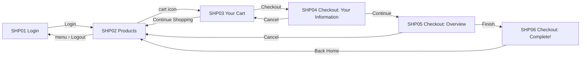

# Screen flow — demo-shop

- Every screen except SHP01 requires login. Opening one without a session → SHP01 with message M05 (spec/messages.md).
- The cart is kept per user after logout / login in the same browser (AC-08).
- Permission matrix: not applicable (no roles); user types are listed in README.md.
